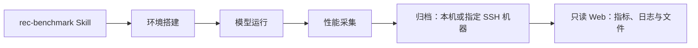

# 推荐模型 Benchmark 平台

**用 Skill 串联环境搭建、模型运行与性能采集，让每次实验都有可追溯的结果。**

本分支 `codex/rec-benchmark-platform-plan` 面向推荐模型在 NVIDIA GPU 与昇腾 NPU 上的性能评测。第一阶段以小型 DLRM、单卡、FP32、eager 和固定步数训练为起点：执行由 Skill 编排，结果默认归档到本机，也可指定 SSH 归档机器，最终通过只读 Web 浏览指标与文件。

> **当前进度 · 2026-11-28**：设备盘点、离线规划、workflow 合同层和 Skill 流程骨架已实现。环境搭建、模型运行、性能采集、归档传输及 Web 浏览尚待实现。当前命令用于采集设备信息、校验配置和生成计划，不会运行 benchmark。

[快速开始](#快速开始) · [当前能力](#当前能力) · [实施计划](docs/recommendation-benchmark-platform-roadmap.md) · [平台方案](docs/recommendation-benchmark-platform-proposal.md)

## 第一阶段目标

| 用户步骤 | 目标能力 | 主要产物 |
|---|---|---|
| 环境搭建 | 盘点设备、选择固定配方、准备容器环境并验证依赖和设备 | 设备快照、环境版本、镜像 digest、准备日志 |
| 模型运行 | 准备固定输入与初始状态，在指定设备完成短跑和数值检查 | 已解析配置、模型/数据/状态指纹、正确性结果、运行日志 |
| 性能采集 | 预热、同步计时、重复测量及可选独立 profiling | 原始样本、吞吐、窗口均摊 step 时间、内存指标、可选 trace |

以下是目标流程，执行与展示环节仍在建设中：



Skill 负责流程选择、命令调用和结果解释；脚本负责设备操作、测量计算、状态记录和文件校验。每次可以只选择一个目标，GPU/NPU 按实际硬件逐一验收。正式测量与 profiling 分开执行，避免采集开销混入性能成绩。

## 当前能力

| 模块 | 已实现 | 当前边界 |
|---|---|---|
| [设备盘点](benchmark_core/inventory/README.md) | OS/厂商采集 profile、本地采集、原始证据、快照与离线汇总 | 发现设备不等于模型运行就绪 |
| [环境与实验规划](benchmark_core/planning/README.md) | 环境配方、BenchmarkSpec、兼容性规则、矩阵展开、指纹与阻塞报告 | 不安装环境、不启动容器 |
| [workflow 合同层](benchmark_core/workflow/README.md) | 单目标解析、分层准入、manifest/指标/产物格式、设备锁与中断记录 | 只提供校验和状态基础，不执行三步流程 |
| [本机归档](benchmark_core/archive/README.md) | staging → 清单 → 校验 → 原子发布 `COMPLETE`；幂等重试与内容冲突检测 | 只有本地 transport；SSH 与 Web 未实现 |
| [rec-benchmark Skill](skills/rec-benchmark/SKILL.md) | 三步编排说明及当前工具使用约定 | 执行入口目前仅有 `check` / `resolve` |
| [配置目录](benchmark_catalog/) | 采集 profile、环境模板、DLRM 实验草案与 workflow 示例 | 模板包含待定版本和 hash，需按实际环境补齐 |

首期建设范围是 Skill 三步执行、本地/SSH 归档与只读 Web。集中调度、常驻 Agent、团队权限、多模型 suite 和 Web 提交任务安排在后续阶段。

## 快速开始

现有工具只依赖 **Python 3.10+ 标准库**。以下命令均从仓库根目录执行；Linux 如使用 `python3`，替换命令中的 `python` 即可。离线校验不需要安装 PyTorch、CUDA 或 CANN。

### 1. 无硬件体验：校验并解析一个 workflow

```console
python -m benchmark_core.workflow check benchmark_catalog/workflows/dlrm-small-local.json
python -m benchmark_core.workflow resolve benchmark_catalog/workflows/dlrm-small-local.json --output benchmark-results/first-resolution
```

`check` 应返回 `valid_structure`。示例只选择 GPU target，但配方仍是 draft，也没有真实设备快照，因此 `resolve` 预期返回 **`blocked`、退出码 3**。这表示计划已经生成且待办被识别，不是模型执行失败。

查看输出目录：

| 文件 | 用途 |
|---|---|
| `request.json` | 原始 workflow、路径、入口工作区和 hash |
| `resolved_workflow.json` | 所选目标、解析后的路径及归档目的地 |
| `resolved_spec.json` | 只包含所选 target 的实验配置 |
| `plan.json` | 离线计划与规则检查结果 |
| `admission.json` | 按结构、环境、工作负载状态、pilot、正式测量划分的准入状态 |

输出目录必须尚不存在，重复体验请换新名称。`execution_ready` 当前恒为 `false`；合同通过仍需后续脚本验证真实执行环境。

### 2. 盘点当前机器

```console
python -m benchmark_core.inventory init --output inventory.local.json --node local-control --backend none
python -m benchmark_core.inventory check --config inventory.local.json
python -m benchmark_core.inventory plan --config inventory.local.json --node local-control
python -m benchmark_core.inventory collect --config inventory.local.json --node local-control --output inventory-results/local-control
```

`plan` 用于预览采集命令，`collect` 在本机执行并保存 `snapshot.json` 与 `report.md`。已有 `inventory.local.json` 时直接复用或选择新文件名；采集也需要新的输出目录。

在 GPU/NPU 节点上初始化配置时，可将 `--backend none` 换成 `nvidia` 或 `ascend`；内置 Ascend profile 仅用于 Linux。按实际设备数量填写配置，节点 hostname/OS 必须与采集机器一致。详细命令、扩展 profile 和汇总方法见[设备盘点文档](benchmark_core/inventory/README.md)。

### 3. 使用自己的配置和快照

参考[示例 workflow](benchmark_catalog/workflows/dlrm-small-local.json)，填写实验、节点与环境配方路径，选择 `target_id`；相对引用以 workflow 文件所在目录为基准。然后解析：

```console
python -m benchmark_core.workflow resolve path/to/workflow.json --snapshot path/to/snapshot.json --output benchmark-results/my-resolution
```

仅需所选目标节点的快照；示例节点和设备 ID 必须替换为实际值。默认快照有效期为 24 小时，可用 `--max-age-hours` 调整。环境配方、模型状态或测量步数尚未确定时，查看 `admission.json` 中的阻塞原因。

需要批量展开多个 target 与 batch 的矩阵时，可使用[离线规划 CLI](benchmark_core/planning/README.md)；单次 Skill 流程以 workflow 的单目标选择为入口。

## 执行与归档配置

**执行机器和归档机器独立配置。** 当前 workflow 合同支持本机执行，归档目的地可声明为本机或 SSH 机器；实际执行和传输脚本待实现。

| 配置 | 约定 |
|---|---|
| `execution.transport` | 当前仅 `local` |
| `archive.transport` | 默认 `local`，可选 `ssh` |
| `archive.host` | 本机为 `localhost`；远端使用已有 SSH 配置别名 |
| `archive.root` | 本机默认入口工作区下 `benchmark-results/archive`；SSH 必须指定远端绝对 POSIX 路径 |
| `archive.web_base_url` | 可选的已部署 Web 地址；未配置时只返回归档位置 |

“本机”指启动 Skill/CLI 的宿主机，不是容器内部。`resolve --entry-workspace` 可指定入口工作区，默认当前目录。以下片段展示远端归档声明，**不会触发上传或部署 Web**：

```json
{
  "archive": {
    "transport": "ssh",
    "host": "bench-archive",
    "root": "/srv/rec-benchmark/archive",
    "web_base_url": null
  }
}
```

规划中的归档流程将保存配置、manifest、原始测量、指标、日志与可选 trace，校验文件大小和 SHA256 后发布。传输失败保留本地文件，单独重试归档；归档完成与模型运行成功分别记录。Web 将部署在归档机器上，提供性能展示、文本预览与文件下载。

## 目录结构

```text
benchmark_core/
  inventory/       # 设备采集与快照
  planning/        # 环境配方、实验合同与离线计划
  workflow/        # 单目标解析、分层准入与状态/产物合同
benchmark_catalog/
  inventory/       # 节点示例与 OS/厂商采集 profile
  environments/    # CUDA / Ascend 环境模板
  experiments/     # 小型 DLRM 实验草案
  workflows/       # 流程与归档配置示例
skills/
  rec-benchmark/   # Skill 流程骨架
docs/              # 平台方案、实施计划、分支边界
```

本地采集输出 `inventory-results/` 和解析输出 `benchmark-results/` 已被 Git 忽略，不应作为真实硬件支持的通用样例提交。

## 开发与后续任务

运行现有 Python 回归测试：

```console
python -m unittest discover -s benchmark_core -v
```

合成设备输出和合同测试验证软件行为；GPU/NPU 运行、计时与 trace 采集须由真实目标节点单独验收。

| 任务 | 当前进度 |
|---|---|
| P1-01：Skill 与运行/归档合同 | 合同层与 Skill 骨架已实现，完整执行验收待完成 |
| P1-02：环境搭建 | 待实现 |
| P1-03：小型 DLRM 运行 | 待实现 |
| P1-04：性能采集 | 待实现 |
| P1-05：本地与 SSH 归档 | 目的地与产物合同已定义，传输/发布待实现 |
| P1-06：只读 Web | 待实现 |

下一步优先实现环境准备脚本，再接入模型短跑与测量，逐步完成“Skill 执行 → 归档 → Web 浏览”的完整流程。

- [第一阶段方案](docs/recommendation-benchmark-platform-proposal.md)：范围、三步职责、归档和 Web 设计。
- [实施计划与验收](docs/recommendation-benchmark-platform-roadmap.md)：P1-01～P1-06 的任务、依赖与完成证据。
- [分支边界记录](docs/recommendation-benchmark-repository-audit.md)：当前模块与历史工具的分离。

## 许可证

[Apache License 2.0](LICENSE)。
