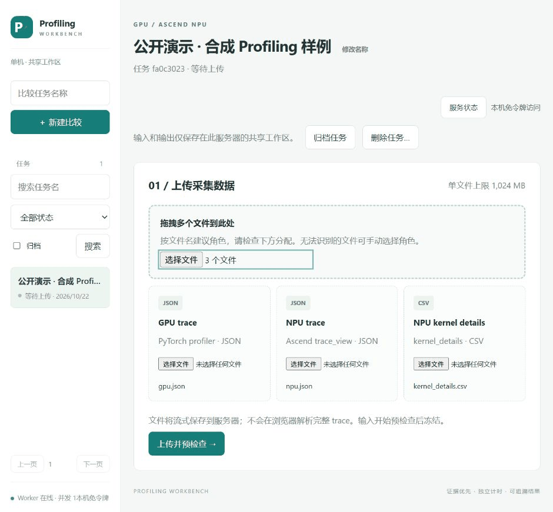
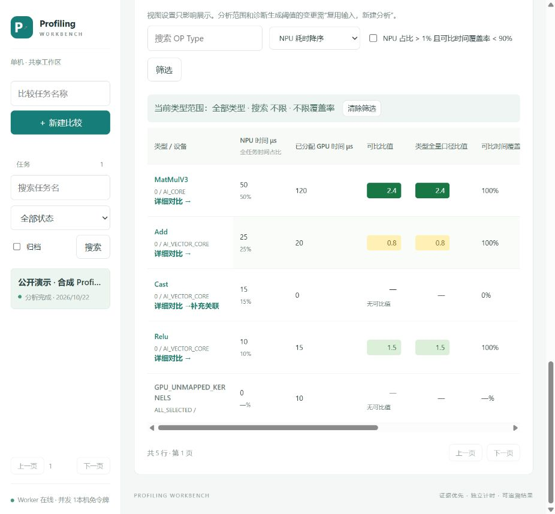
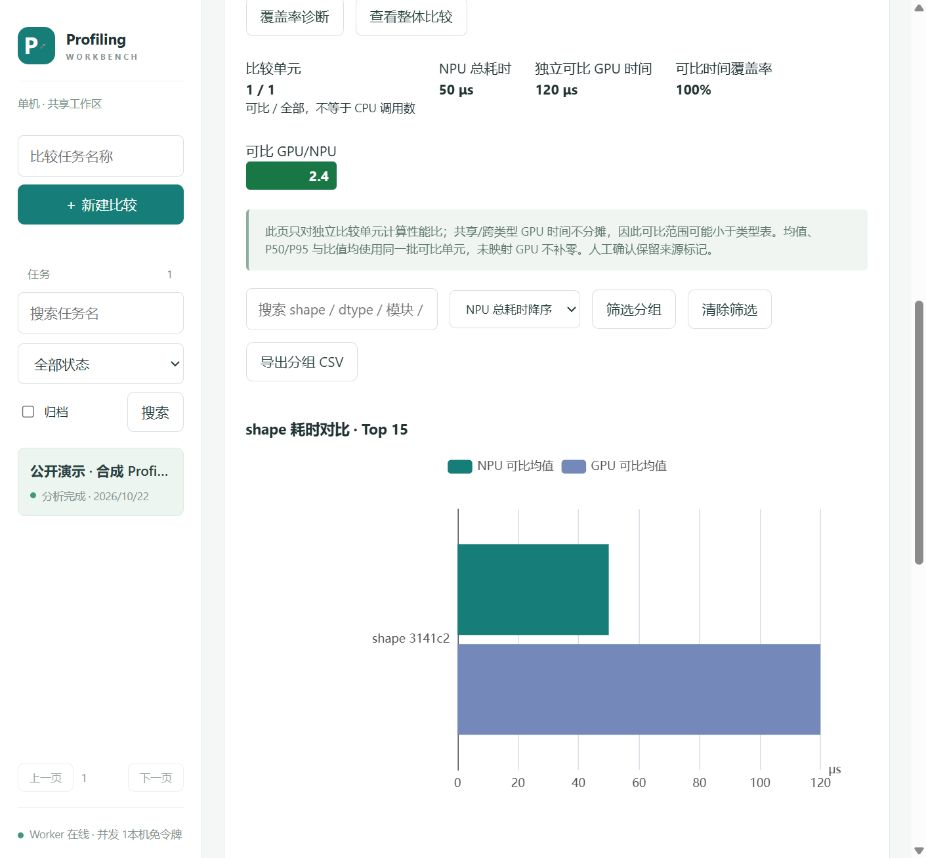

<h1 align="center">GPU/NPU Profiling Workbench</h1>

<p align="center"><strong>上传两端 Profiling，定位性能差异，解释覆盖率缺口。</strong></p>
<p align="center">PyTorch GPU × Ascend NPU · 本地分析 · Web / CLI / Skill · Excel 报告</p>
<p align="center">
  <a href="#界面演示">界面演示</a> ·
  <a href="#快速开始">快速开始</a> ·
  <a href="#跑一个公开样例">公开样例</a> ·
  <a href="#如何读懂结果">结果口径</a> ·
  <a href="profiling_web/README.md">部署文档</a> ·
  <a href="LICENSE">Apache-2.0</a>
</p>

GPU 和 NPU 的 kernel 名称、数量、融合方式不同，直接按名字比较往往行不通。本工具从 **NPU kernel → CPU 调用 → GPU kernel** 建立关联，以 NPU 类型为主轴比较耗时，并把不能独立比较的工作保留为整体调用或未映射证据。

不需要在分析机器上安装 GPU/NPU 硬件；Web 分析不调用外部 AI 服务。它是采集后的对比工作台，不是 profiler 采集器，也不是自动证明两端模型等价的工具。

## 界面演示



*真实 Web 界面的分步截图 GIF，省略等待过程，不代表分析速度。输入为仓库中的合成样例，结果由分析引擎实际生成；数值不是硬件 benchmark。*

<details>
<summary>查看静态截图：上传 / 类型结果 / Shape 图表</summary>

**上传三份输入，确认各自角色。**


**先看类型耗时和覆盖率，再定位缺口。**



**从类型进入详情，查看 Shape / dtype 与可比耗时。**



</details>

## 能解决什么问题

| 你想知道 | 从哪里开始 |
|---|---|
| 哪类 NPU 算子耗时最多？两侧差多少？ | **类型对比**：类型占比、可比倍率、类型全量口径比值 |
| kernel 数量对不上，能否整组比较？ | **整体对比**：查看已有 CPU 调用/融合比较单元，避免强行一一配对 |
| 为什么覆盖率低？该先查哪里？ | **覆盖率诊断**：按未可比时间定位原因、证据和排查建议 |
| 哪个 Shape / dtype 的表现不同？ | **算子详情**：元数据分组、可比均值、图表和逐次证据 |
| 自动映射漏掉了已人工确认的调用？ | **补充关联**：候选预览、批量确认、理由留痕、撤销 |
| 如何交付分析结论？ | **Excel / CSV / Markdown / JSON**：可读报告与机器可读证据 |

还可查看 NPU Cube/Vector 耗时构成、GPU 对齐后的参考分类，以及 NPU 流水瓶颈候选。缺少计数器时保留 Unknown，不把候选标签当作已证实的硬件瓶颈。

## 快速开始

以下命令在克隆后的仓库根目录运行。Web 验证环境为 **Python 3.12、Node.js 22、pnpm 11.25.0**；分析核心仅需 Python 3.9+ 标准库。

### 启动 Web

Windows PowerShell：

```powershell
python -m venv profiling_web/.venv
profiling_web/.venv/Scripts/python -m pip install -r profiling_web/requirements.lock.txt
pnpm --dir profiling_web/frontend install --frozen-lockfile
pnpm --dir profiling_web/frontend build
profiling_web/.venv/Scripts/python -m profiling_web
```

打开 **http://127.0.0.1:8000**。默认本机部署无需令牌。构建完成后，日常启动只需最后一条命令。

<details>
<summary>Linux / macOS 命令</summary>

```bash
python3 -m venv profiling_web/.venv
profiling_web/.venv/bin/python -m pip install -r profiling_web/requirements.lock.txt
pnpm --dir profiling_web/frontend install --frozen-lockfile
pnpm --dir profiling_web/frontend build
profiling_web/.venv/bin/python -m profiling_web
```

</details>

Docker、局域网认证、资源限制与恢复方法见 [Web 部署文档](profiling_web/README.md)。服务定位为**单机、可信用户共享工作区**，不是多租户服务，不应直接暴露公网。

### 完成第一次比较

1. **新建任务**：填写能区分模型与采集条件的名称。
2. **上传数据**：GPU trace JSON、NPU trace JSON、对应的 NPU `kernel_details.csv`。`op_statistic.csv` 不能替代 kernel 明细。
3. **确认范围**：预检查后选择两端 CPU PID 与稳定 Step；确认 Batch、Shape、精度和设备范围一致。相同 Step 编号不代表工作量等价。
4. **分析与查证**：先看类型对比，再进入算子详情、整体对比与覆盖率诊断。不要为了让覆盖率变高而强行关联。
5. **导出报告**：下载多页签 Excel，或导出当前筛选的 CSV。需要改变范围时使用“复用输入，新建分析”。

## 跑一个公开样例

不用准备业务数据，上传这三份文件即可体验：

- [GPU trace](docs/demo/gpu.json)
- [NPU trace](docs/demo/npu.json)
- [NPU kernel_details.csv](docs/demo/kernel_details.csv)

选择 **GPU PID 1 / NPU PID 3，两侧 Step 1**。样例故意保留一个 NPU 独有调用和一个未映射 GPU kernel，展示“分析成功但仍有覆盖缺口”。

实际生成的关键结果如下（单位 μs）：

| NPU 类型 | NPU 总时间 | 已分配 GPU 时间 | 可比 GPU/NPU | NPU 可比时间覆盖率 |
|---|---:|---:|---:|---:|
| MatMulV3 | 50 | 120 | 2.40× | 100% |
| Add | 25 | 20 | 0.80× | 100% |
| Relu | 10 | 15 | 1.50× | 100% |
| Cast | 15 | 未分配 | — | 0% |

另有 **10 μs GPU 未映射时间**，仍纳入总体记账。总体 NPU 时间为 100 μs、GPU 时间为 165 μs；可比子集为 NPU 85 μs / GPU 155 μs。因此，可比倍率约 **1.824×**，总时间倍率为 **1.65×**，不能互换。

样例通过 **107 项一致性校验**。这证明当前结果通过记账检查，不证明每项映射语义或实际模型精度等价。

查看 [样例说明与复现命令](docs/demo/README.md)。所有输入均为合成数据；不包含业务模型、用户目录或私有采集日志。

## 如何读懂结果

| 指标 | 含义 | 不意味着什么 |
|---|---|---|
| Comparable Ratio | 对应可比 GPU 时间 / 可比 NPU 时间 | 不代表未覆盖部分，也不等于整步加速比 |
| 类型全量口径比值 | 已分配 GPU 时间 / 该 NPU 类型全部时间 | 低覆盖时不是完整同类工作比较 |
| TOTAL 总时间倍率 | 所选 GPU 计算与内存活动时间 / NPU 明细支持的 kernel 时间 | 不是等价工作量或墙钟加速证明 |
| Direct 覆盖率 | 有独立直接配对的 NPU 工作 | 不等于整体调用可比覆盖率 |
| Comparable 覆盖率 | 按已建立比较粒度可比较的 NPU 工作 | 不保证组内每个 kernel 可独立分摊 |
| Accounted 覆盖率 | 已解释归属/用途的 NPU 工作 | 不一定可以独立比较性能 |

覆盖率分别统计**数量与 NPU 时间**，定位热点优先看时间覆盖率。Duration 求和包含并发重叠，不是 Step 墙钟时间；类型与整体调用是重叠视角，不能相加。GPU 未映射不代表 NPU 对应工作成本为零。

性能比统一使用 **GPU/NPU**：可比范围内，≥2 为深绿色，≥1 且 <2 为浅绿色，<1 为黄色。颜色仅辅助阅读，不替代证据。完整定义见 [核心工具文档](profiling_tools/README.md) 和 [指标约定](skills/gpu-npu-profiling/references/metrics.md)。

## 报告与分析入口

| 输出 | 用途 |
|---|---|
| `npu_gpu_op_statistic.xlsx` | 类型对比、整体对比、覆盖率诊断、调用明细、耗时分布五个页签 |
| `npu_gpu_op_statistic.csv` | 完整类型级统计 |
| `npu_kernel_gpu_mapping.csv` | NPU kernel → CPU/GPU 的逐项证据 |
| `coverage_diagnostics.md` | 低覆盖率类型的通用排查报告 |
| `gpu_unmapped_activity.csv` | 未分配 GPU 计算与内存活动 |
| `summary.json` / `validation.json` | 摘要、记账校验状态 |

### CLI / 自动化

不需要 Web 或前端依赖。下面的命令使用同一组公开样例：

```bash
python -m profiling_tools inspect --gpu-trace docs/demo/gpu.json --npu-trace docs/demo/npu.json --npu-kernel-details docs/demo/kernel_details.csv
python -m profiling_tools compare --gpu-trace docs/demo/gpu.json --npu-trace docs/demo/npu.json --npu-kernel-details docs/demo/kernel_details.csv --gpu-pid 1 --npu-pid 3 --gpu-step 1 --npu-step 1 --output-dir result-demo --json
python -m profiling_tools validate --result-dir result-demo
python -m profiling_tools summary --result-dir result-demo
python -m profiling_tools query --result-dir result-demo --op-type Cast --limit 5
```

每次使用新的/空的输出目录。也可 `python -m pip install ./profiling_tools` 独立安装核心包。参数和错误码见 [CLI 文档](profiling_tools/README.md)。

### Skill 与实验性建模

- [gpu-npu-profiling Skill](skills/gpu-npu-profiling/)：封装输入契约、稳定命令、证据查询和排查流程，复用同一套引擎，不维护另一套算法。
- [Workload Modeler](workload_modeler/README.md)：独立的单机建模 MVP，用于规格管理和假设下的耗时折算。预测不是双侧实测，不与本工作台的实测比较混为一谈。

## 常见问题

**为什么分析成功但覆盖率不是 100%？**

采集元数据缺失、CPU 调用结构差异、融合与多对多关系，都可能阻止独立比较。先查诊断及对应调用；保留缺口比重复分配 GPU 耗时更可靠。

**自动对齐不准怎么办？**

核对两端范围与调用证据后，可使用 [人工补充关联](profiling_web/README.md#人工补充-gpu-关联)。支持预览、同类批量确认和撤销；人工确认明确标记为非自动验证，不改写原始 owner。

**可以只上传 GPU 数据预测 NPU 吗？**

本工作台的实测比较需要三份输入。单侧估算请看独立的 Workload Modeler，结果受模型覆盖和规格假设限制。

**上传很大的 Trace 会怎样？**

Web 流式接收文件，但解析器仍完整加载 JSON。先选择合理的采集范围，并按部署文档设置上传、内存、磁盘与超时限制。

## 开发与验证

```bash
python -m unittest discover -s profiling_tools/tests -v
```

Web 回归测试使用已安装依赖的环境：

```powershell
profiling_web/.venv/Scripts/python -m unittest discover -s profiling_web/tests -v
```

| 目录 | 职责 |
|---|---|
| `profiling_tools/` | 解析、对齐、时间记账、诊断与报告引擎 |
| `profiling_web/` | 单机 API / Worker、Vue + ECharts 工作台 |
| `skills/gpu-npu-profiling/` | 可分发 Skill |
| `workload_modeler/` | 实验性规格管理与性能建模 |
| `docs/demo/` / `docs/media/` | 公开样例、复现说明、真实界面演示 |

反馈问题时请提供工具版本、两侧采集版本、选择范围和错误信息；优先提供最小可复现样例。公开提交前请移除模型名、路径、调用栈等敏感信息。

## 许可证

[Apache License 2.0](LICENSE)。
