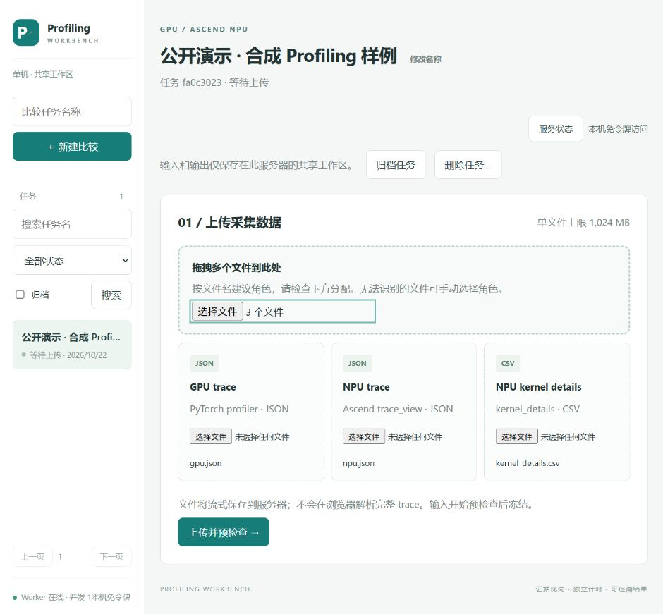
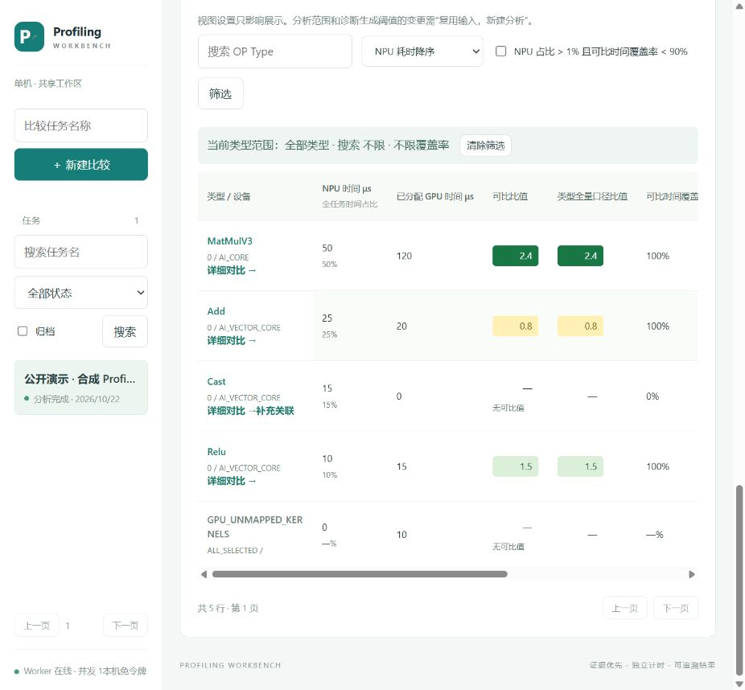
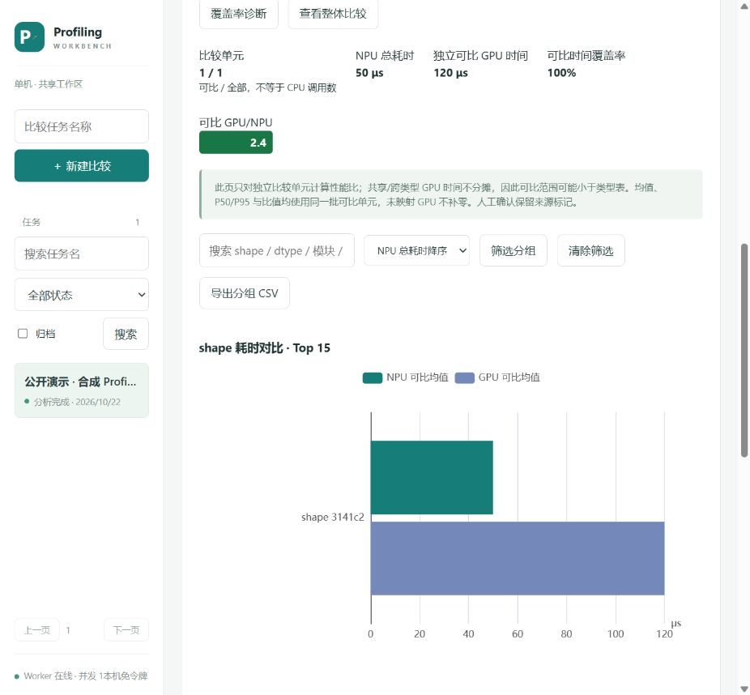

<h1 align="center">GPU/NPU Profiling 工具集</h1>

<p align="center"><strong>Profiling Workbench 做双侧实测对比，Workload Modeler 做单侧画像与性能估算。</strong></p>
<p align="center">PyTorch GPU × Ascend NPU · 本地处理 · 独立 Web 服务 · 可追溯报告</p>
<p align="center">
  <a href="#选择工具">选择工具</a> ·
  <a href="#界面演示">界面演示</a> ·
  <a href="#快速开始">快速开始</a> ·
  <a href="#workload-使用流程与结果">Workload 使用流程</a> ·
  <a href="profiling_web/README.md">Profiling 文档</a> ·
  <a href="workload_modeler/README.md">Workload 文档</a> ·
  <a href="LICENSE">Apache-2.0</a>
</p>

本仓库提供两个可以分别启动的工具，分析机器均无需安装 GPU/NPU 硬件，Web 分析不调用外部 AI 服务。

## 选择工具

| 对比项 | Profiling Workbench | Workload Modeler |
|---|---|---|
| 要解决的问题 | 两端已经实测：差在哪里，为什么没有对齐？ | 只有一端采集：换设备后可能怎样，哪些假设影响结果？ |
| 输入 | GPU Trace + NPU Trace + NPU `kernel_details.csv` | GPU Trace；或 NPU Trace + 明细；也支持仅 NPU 明细 |
| 主要能力 | kernel 对齐、类型/整体对比、Shape 分析、人工关联、覆盖率诊断 | 芯片与平台版本管理、Cube/Vector 画像、精细建模、整体经验估算 |
| 比值口径 | 对应范围的 GPU 实测耗时 / NPU 实测耗时 | 源设备实测耗时 / 目标设备预测耗时 |
| 主要输出 | 多页签 Excel、CSV、Markdown、JSON | 网页表格与图表、CSV、JSON、经验场景 JSON |
| 默认地址 | `http://127.0.0.1:8000` | `http://127.0.0.1:8770` |
| 服务与数据 | `profiling_web/`；`profiling_web/data/` | `workload_modeler/`；`workload_modeler/data/` |
| 前端依赖 | Vue + ECharts，首次需 Node.js / pnpm 构建 | 原生静态页面，无需 Node.js 构建 |
| 详细说明 | [Profiling 部署与操作](profiling_web/README.md) | [Workload 部署、模型与假设](workload_modeler/README.md) |

两套服务可同时运行，任务和数据目录独立；共用解析能力及 `web_shared/` 界面主题，不会自动同步任务。**Workload 的预测倍率不能当作 Profiling 的双侧实测倍率。** 可先用 Workload 筛选迁移方案，再采集目标设备数据，用 Profiling 验证。

GPU 和 NPU 的 kernel 名称、数量、融合方式不同，直接按名字比较往往行不通。Profiling Workbench 从 **NPU kernel → CPU 调用 → GPU kernel** 建立关联，以 NPU 类型为主轴比较耗时，并把不能独立比较的工作保留为整体调用或未映射证据。


## 界面演示

以下演示为 **Profiling Workbench 双侧对比服务**；Workload 的输入和使用流程见下文独立说明。


*真实 Web 界面的分步截图 GIF，省略等待过程，不代表分析速度。输入为仓库中的合成样例，结果由分析引擎实际生成；数值不是硬件 benchmark。*

<details>
<summary>查看静态截图：上传 / 类型结果 / Shape 图表</summary>

**上传三份输入，确认各自角色。**



**先看类型耗时和覆盖率，再定位缺口。**



**从类型进入详情，查看 Shape / dtype 与可比耗时。**



</details>

## 能解决什么问题

| 你想知道 | 从哪里开始 |
|---|---|
| 哪类 NPU 算子耗时最多？两侧差多少？ | **类型对比**：类型占比、可比倍率、类型全量口径比值 |
| kernel 数量对不上，能否整组比较？ | **整体对比**：查看已有 CPU 调用/融合比较单元，避免强行一一配对 |
| 为什么覆盖率低？该先查哪里？ | **覆盖率诊断**：按未可比时间定位原因、证据和排查建议 |
| 哪个 Shape / dtype 的表现不同？ | **算子详情**：元数据分组、可比均值、图表和逐次证据 |
| 自动映射漏掉了已人工确认的调用？ | **补充关联**：候选预览、批量确认、理由留痕、撤销 |
| 如何交付分析结论？ | **Excel / CSV / Markdown / JSON**：可读报告与机器可读证据 |

还可查看 NPU Cube/Vector 耗时构成、GPU 对齐后的参考分类，以及 NPU 流水瓶颈候选。缺少计数器时保留 Unknown，不把候选标签当作已证实的硬件瓶颈。

## 快速开始

以下命令在克隆后的仓库根目录运行。Profiling Web 验证环境为 **Python 3.12、Node.js 22、pnpm 11.25.0**；Profiling 分析核心仅需 Python 3.9+ 标准库。Workload 的依赖和启动命令单独列在下方。

### 启动 Profiling Workbench（8000）

Windows PowerShell：

```powershell
python -m venv profiling_web/.venv
profiling_web/.venv/Scripts/python -m pip install -r profiling_web/requirements.lock.txt
pnpm --dir profiling_web/frontend install --frozen-lockfile
pnpm --dir profiling_web/frontend build
profiling_web/.venv/Scripts/python -m profiling_web
```

打开 **http://127.0.0.1:8000**。默认本机部署无需令牌。构建完成后，日常启动只需最后一条命令。

<details>
<summary>Linux / macOS 命令</summary>

```bash
python3 -m venv profiling_web/.venv
profiling_web/.venv/bin/python -m pip install -r profiling_web/requirements.lock.txt
pnpm --dir profiling_web/frontend install --frozen-lockfile
pnpm --dir profiling_web/frontend build
profiling_web/.venv/bin/python -m profiling_web
```

</details>

Docker、局域网认证、资源限制与恢复方法见 [Web 部署文档](profiling_web/README.md)。服务定位为**单机、可信用户共享工作区**，不是多租户服务，不应直接暴露公网。

### 启动 Workload Modeler（8770）

Python 3.10+，无需安装 Node.js 或构建前端。在仓库根目录创建独立环境：

```powershell
python -m venv workload_modeler/.venv
workload_modeler/.venv/Scripts/python -m pip install -r workload_modeler/requirements.txt
workload_modeler/.venv/Scripts/python -m workload_modeler --port 8770
```

Linux / macOS：

```bash
python3 -m venv workload_modeler/.venv
workload_modeler/.venv/bin/python -m pip install -r workload_modeler/requirements.txt
workload_modeler/.venv/bin/python -m workload_modeler --port 8770
```

打开 **http://127.0.0.1:8770**。服务仅监听本机、无需令牌；在终端按 `Ctrl+C` 停止。日常只需最后一条启动命令，历史任务保存在 `workload_modeler/data/`。部署时保留仓库中的 `profiling_tools/` 和 `web_shared/`；当前 Profiling 的 Docker 配置仅用于 Profiling 服务。

上传上限默认 2 GiB/文件。大文件参数、备份、恢复和版本化规格管理见 [Workload README](workload_modeler/README.md)。

### 完成第一次 Profiling 比较

1. **新建任务**：填写能区分模型与采集条件的名称。
2. **上传数据**：GPU trace JSON、NPU trace JSON、对应的 NPU `kernel_details.csv`。`op_statistic.csv` 不能替代 kernel 明细。
3. **确认范围**：预检查后选择两端 CPU PID 与稳定 Step；确认 Batch、Shape、精度和设备范围一致。相同 Step 编号不代表工作量等价。
4. **分析与查证**：先看类型对比，再进入算子详情、整体对比与覆盖率诊断。不要为了让覆盖率变高而强行关联。
5. **导出报告**：下载多页签 Excel，或导出当前筛选的 CSV。需要改变范围时使用“复用输入，新建分析”。

## Workload 使用流程与结果

1. **确认设备**：在「芯片规格 / 平台配置」选择源设备与目标设备。内置 L20、950PR 标卡 28/32 Cube、A100 40/80GB PCIe/SXM、950DT 28/32/36 Cube；支持新建、修改、历史版本和 JSON 导入导出。规格来源与未确认参数见 [设备说明](workload_modeler/docs/device_presets.md)。
2. **上传一端采集**：新建任务，选择 GPU 或 NPU 输入类型、源/目标平台与文件。点击主按钮自动上传；可开启「预检查范围」，检查 PID、Step 和设备后运行分析。
3. **查看画像与估算**：先看设备整体、整步经验倍率，再检查算子折算、Cube/Vector 时间构成、精细建模覆盖率及未知原因。可调整经验假设预览结果，无需重新解析 Trace。
4. **保存与管理**：下载 CSV / JSON 或导出经验场景；支持改名、复用输入、搜索和取消任务。任务、芯片、平台可移入回收站并恢复，历史结果继续保留分析时的规格快照。

快速体验可上传 [GPU 合成样例](workload_modeler/examples/gpu_trace.json)，输入类型选 GPU，源平台选 L20、目标选 950PR，Step 选 `ProfilerStep#1`。也可使用 [NPU 明细样例](workload_modeler/examples/kernel_details.csv)，输入类型选 NPU、源/目标都选 950PR 32、Step 选 1。样例仅验证功能，不代表真实设备性能。

| Workload 结果 | 怎么读 |
|---|---|
| 画像与亲和性初筛 | 统计算子与 Cube-like/Vector-like 构成；用于定位主导工作，不直接证明目标设备更快 |
| 精细预测与覆盖率 | 仅对满足 Shape、dtype、规格和实现假设的调用建模；缺少证据的部分保留未知 |
| 整体经验估算 | 按互斥时间类别与可编辑倍率折算全量设备时间；即使精细覆盖率低，也可输出带假设的场景 |
| 整步预测 | 依赖 Step 窗口、重叠和间隙假设；设备 Duration 求和不等于整步墙钟耗时 |

经验估算的保守/基准/乐观值表示假设敏感性，不是实测值或统计置信区间。当前仅支持单设备建模，不提供完整的多卡调度仿真。完整公式、边界与用法见 [Workload 文档](workload_modeler/README.md)。

## 跑一个公开样例

以下为 **Profiling 双侧对比样例**。不用准备业务数据，上传这三份文件即可体验：

- [GPU trace](docs/demo/gpu.json)
- [NPU trace](docs/demo/npu.json)
- [NPU kernel_details.csv](docs/demo/kernel_details.csv)

选择 **GPU PID 1 / NPU PID 3，两侧 Step 1**。样例故意保留一个 NPU 独有调用和一个未映射 GPU kernel，展示“分析成功但仍有覆盖缺口”。

实际生成的关键结果如下（单位 μs）：

| NPU 类型 | NPU 总时间 | 已分配 GPU 时间 | 可比 GPU/NPU | NPU 可比时间覆盖率 |
|---|---:|---:|---:|---:|
| MatMulV3 | 50 | 120 | 2.40× | 100% |
| Add | 25 | 20 | 0.80× | 100% |
| Relu | 10 | 15 | 1.50× | 100% |
| Cast | 15 | 未分配 | — | 0% |

另有 **10 μs GPU 未映射时间**，仍纳入总体记账。总体 NPU 时间为 100 μs、GPU 时间为 165 μs；可比子集为 NPU 85 μs / GPU 155 μs。因此，可比倍率约 **1.824×**，总时间倍率为 **1.65×**，不能互换。

样例通过 **107 项一致性校验**。这证明当前结果通过记账检查，不证明每项映射语义或实际模型精度等价。

查看 [样例说明与复现命令](docs/demo/README.md)。所有输入均为合成数据；不包含业务模型、用户目录或私有采集日志。

## 如何读懂结果

本节口径适用于 **Profiling Workbench**；Workload 使用上文的源/目标预测口径。

| 指标 | 含义 | 不意味着什么 |
|---|---|---|
| Comparable Ratio | 对应可比 GPU 时间 / 可比 NPU 时间 | 不代表未覆盖部分，也不等于整步加速比 |
| 类型全量口径比值 | 已分配 GPU 时间 / 该 NPU 类型全部时间 | 低覆盖时不是完整同类工作比较 |
| TOTAL 总时间倍率 | 所选 GPU 计算与内存活动时间 / NPU 明细支持的 kernel 时间 | 不是等价工作量或墙钟加速证明 |
| Direct 覆盖率 | 有独立直接配对的 NPU 工作 | 不等于整体调用可比覆盖率 |
| Comparable 覆盖率 | 按已建立比较粒度可比较的 NPU 工作 | 不保证组内每个 kernel 可独立分摊 |
| Accounted 覆盖率 | 已解释归属/用途的 NPU 工作 | 不一定可以独立比较性能 |

覆盖率分别统计**数量与 NPU 时间**，定位热点优先看时间覆盖率。Duration 求和包含并发重叠，不是 Step 墙钟时间；类型与整体调用是重叠视角，不能相加。GPU 未映射不代表 NPU 对应工作成本为零。

性能比统一使用 **GPU/NPU**：可比范围内，≥2 为深绿色，≥1 且 <2 为浅绿色，<1 为黄色。颜色仅辅助阅读，不替代证据。完整定义见 [核心工具文档](profiling_tools/README.md) 和 [指标约定](skills/gpu-npu-profiling/references/metrics.md)。

## 报告与分析入口

| 输出 | 用途 |
|---|---|
| `npu_gpu_op_statistic.xlsx` | 类型对比、整体对比、覆盖率诊断、调用明细、耗时分布五个页签 |
| `npu_gpu_op_statistic.csv` | 完整类型级统计 |
| `npu_kernel_gpu_mapping.csv` | NPU kernel → CPU/GPU 的逐项证据 |
| `coverage_diagnostics.md` | 低覆盖率类型的通用排查报告 |
| `gpu_unmapped_activity.csv` | 未分配 GPU 计算与内存活动 |
| `summary.json` / `validation.json` | 摘要、记账校验状态 |

### CLI / 自动化

不需要 Web 或前端依赖。下面的命令使用同一组公开样例：

```bash
python -m profiling_tools inspect --gpu-trace docs/demo/gpu.json --npu-trace docs/demo/npu.json --npu-kernel-details docs/demo/kernel_details.csv
python -m profiling_tools compare --gpu-trace docs/demo/gpu.json --npu-trace docs/demo/npu.json --npu-kernel-details docs/demo/kernel_details.csv --gpu-pid 1 --npu-pid 3 --gpu-step 1 --npu-step 1 --output-dir result-demo --json
python -m profiling_tools validate --result-dir result-demo
python -m profiling_tools summary --result-dir result-demo
python -m profiling_tools query --result-dir result-demo --op-type Cast --limit 5
```

每次使用新的/空的输出目录。也可 `python -m pip install ./profiling_tools` 独立安装核心包。参数和错误码见 [CLI 文档](profiling_tools/README.md)。

### Skill

- [gpu-npu-profiling Skill](skills/gpu-npu-profiling/)：封装输入契约、稳定命令、证据查询和排查流程，复用同一套引擎，不维护另一套算法。

## 常见问题

**为什么分析成功但覆盖率不是 100%？**

采集元数据缺失、CPU 调用结构差异、融合与多对多关系，都可能阻止独立比较。先查诊断及对应调用；保留缺口比重复分配 GPU 耗时更可靠。

**自动对齐不准怎么办？**

核对两端范围与调用证据后，可使用 [人工补充关联](profiling_web/README.md#人工补充-gpu-关联)。支持预览、同类批量确认和撤销；人工确认明确标记为非自动验证，不改写原始 owner。

**可以只上传 GPU 数据预测 NPU 吗？**

Profiling Workbench 的实测比较需要三份输入。单侧估算使用 [Workload Modeler](workload_modeler/README.md)，结果受模型覆盖和规格假设限制。

**两个服务需要一起启动吗？**

不需要。只做单侧画像和预测时启动 8770 的 Workload 即可；做双侧实测比较时启动 8000 的 Profiling。两者可并行，但同一服务的数据目录不要被多个实例同时打开。

**上传很大的 Trace 会怎样？**

Web 流式接收文件，但解析器仍完整加载 JSON。先选择合理的采集范围，并按部署文档设置上传、内存、磁盘与超时限制。

## 开发与验证

```bash
python -m unittest discover -s profiling_tools/tests -v
```

Web 回归测试使用已安装依赖的环境：

```powershell
profiling_web/.venv/Scripts/python -m unittest discover -s profiling_web/tests -v
```

Workload 回归测试（`httpx` 用于 API 测试，Node.js 仅用于前端逻辑测试）：

```powershell
workload_modeler/.venv/Scripts/python -m pip install httpx
workload_modeler/.venv/Scripts/python -m unittest discover -s workload_modeler/tests -v
node --test workload_modeler/tests/workflow.test.cjs workload_modeler/tests/management.test.cjs
```

| 目录 | 职责 |
|---|---|
| `profiling_tools/` | 解析、对齐、时间记账、诊断与报告引擎 |
| `profiling_web/` | 单机 API / Worker、Vue + ECharts 工作台 |
| `skills/gpu-npu-profiling/` | 可分发 Skill |
| `workload_modeler/` | 独立单机服务：规格/平台管理、单侧画像与性能估算 |
| `web_shared/` | 两套 Web 服务共用的界面主题 |
| `docs/demo/` / `docs/media/` | 公开样例、复现说明、真实界面演示 |

反馈问题时请提供工具版本、两侧采集版本、选择范围和错误信息；优先提供最小可复现样例。公开提交前请移除模型名、路径、调用栈等敏感信息。

## 许可证

[Apache License 2.0](LICENSE)。
