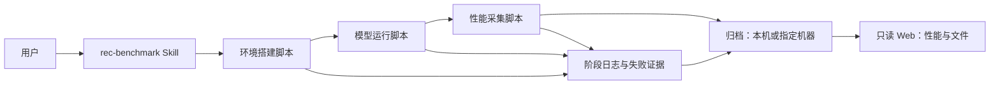

# 推荐模型 Benchmark 平台：第一阶段方案

调整日期：2026-11-25。当前目标为 **Skill 驱动环境搭建、模型运行、性能采集；结果默认归档到本机，也可指定归档机器；Web 浏览性能与归档文件**。本版替代原先以集中控制面、节点 Agent 和多模型 suite 为首期前提的方案。任务拆分见[实施计划](recommendation-benchmark-platform-roadmap.md)。

当前已实现设备盘点和离线实验规划。以下 Skill、运行脚本、归档和 Web 均是待实现设计，不能据此认为已有可用命令或硬件支持。

## 第一阶段范围

先用一个小型 DLRM 打通单卡、FP32、eager、固定步数 train step。保留 CUDA 与 Ascend 两种后端，按实际可用硬件逐一验收；一次只选择一个目标运行，不要求 GPU/NPU 成对提交。先完成一个后端的完整流程，再复用到另一个后端；未实测的后端明确标注“待验证”。

用户的三步操作保持为：

| 步骤 | Skill 负责组织的动作 | 脚本负责的确定性动作 | 产物 |
|---|---|---|---|
| 1. 环境搭建 | 选择机器与环境配方，检查前提，执行准备，解释失败 | 设备盘点、配方校验、准备锁定镜像、设备透传验证、依赖与算子 smoke | 设备快照、环境版本、镜像 digest、准备日志、smoke 结果 |
| 2. 模型运行 | 选择模型与参数，执行短跑，确认能进入测量 | 准备固定输入/初始状态，显式选择设备，前向/反向/更新检查 | 已解析配置、源码/数据/状态 hash、运行日志、正确性结果 |
| 3. 性能采集 | 确定测量协议，调用采集，检查完整性并归档 | pilot、固定步数测量、重复汇总、可选独立 profiling、归档校验 | 原始样本、吞吐/时间/内存指标、可选 trace、manifest、文件清单 |

归档属于三步流程的收尾，用户无需再掌握一套任务系统；失败时也尽可能归档已有日志和状态。Web 可在归档后浏览结果，不参与环境搭建、模型提交和流程控制。

首期不建设集中调度、常驻节点 Agent、PostgreSQL、设备租约服务、团队权限系统或 Web 任务编辑器。只支持用户明确选择的设备，运行脚本在本机持有设备互斥锁并检查占用；不自动选卡、抢占或排队。三模型 suite、真实数据业务质量评估、多卡多机、自动回归、训练达标时间和服务推理延后。

## Skill 与脚本的分工

`rec-benchmark` Skill 是主入口和流程编排者：收集参数 → 选择配方 → 调用环境准备 → 调用模型短跑 → 调用性能采集 → 校验归档 → 返回摘要和链接。Skill 决定下一步、处理结构化错误、按需重试归档；不依赖一个新的提交任务 API 才能工作。

脚本提供可重复执行的具体动作，不从自然语言或日志猜测成功：使用退出码、阶段结果 JSON 和实际产物判定。模型输出、同步计时、指标统计、hash 和文件传输由脚本计算；Skill 读取结果后解释，不自行计算另一套成绩。手动 CLI 与 Skill 调用同一实现，便于调试和重放。

Skill 每步核对 `run_id / attempt_id` 与输入 hash，并把阶段日志落盘。首次建 run 后，在同一 attempt 中完成三步；重新执行模型或测量使用新 attempt。归档重试沿用原 attempt，不重新跑模型。中断后检查进程、互斥锁和已有产物，再明确继续或新建 attempt；首期不承诺对话结束后自动后台续跑。



图中顺序由 Skill 编排，脚本间不需要消息队列或常驻调度服务。

## 执行机器与归档机器

两者独立配置。执行机器承载模型进程，归档机器保存已完成或失败实验的证据。第一阶段先支持在执行机器上启动 Skill/CLI；跨机器模型调度放到后续，**指定远程归档机器纳入第一阶段**。

“本机”固定指启动本次 Skill/CLI 流程的宿主机，不是容器内部。归档默认路径为该入口工作区的 `benchmark-results/archive`，入口启动时转换为绝对路径并记录主机身份。默认执行也在该宿主机。将来增加远程执行时，不能因此悄悄改变默认归档位置。

| 配置 | 默认与约束 |
|---|---|
| `execution` | 第一阶段使用 `local`，显式指定 backend 与设备标识 |
| `archive.transport` | 默认 `local`；可选择 `ssh` |
| `archive.host` | local 时为 localhost；ssh 时使用已有 SSH 配置别名 |
| `archive.root` | local 默认工作区下的 `benchmark-results/archive`；ssh 必须显式填写目标机绝对路径 |
| `archive.web_base_url` | 可选，指向已启动的归档浏览服务；未配置时仅返回归档位置，不编造网页链接 |

归档使用本机目录或 SSH/SFTP，不要求部署节点 Agent。远端只需可写归档目录、SSH/SFTP 和用于校验/发布的轻量 Python helper；凭证使用既有 SSH 配置，不写进实验 manifest。先预检连接、权限和空间，网络故障时保留执行机上的完整暂存目录，提供只重试归档的入口。

以下为拟新增的独立 workflow 配置草案，**目前 CLI 不接受此 schema**。已有 BenchmarkSpec 严格拒绝未知字段，不将归档配置直接塞进其 v1 对象。

```json
{
  "schema_version": "recbench.workflow/v1",
  "benchmark_spec": "experiments.local.json",
  "inventory_config": "inventory.local.json",
  "environment_recipe": "cuda.local.json",
  "target_id": "gpu",
  "execution": {"transport": "local"},
  "archive": {"transport": "local", "host": "localhost", "root": "benchmark-results/archive", "web_base_url": null},
  "profile": {"enabled": false}
}
```

`benchmark_spec` 的目标引用作为 backend、设备和配方身份的唯一来源；`target_id` 选择其中一个目标。执行脚本从原声明派生仅含所选 target 的有效配置，保留原始声明及其 hash，然后调用现有校验；不改写原文件，也不要求未选目标的快照或配方。示例路径须由用户配置，所有相对路径以 workflow 文件目录为基准解析。`archive.root` 未填写时使用入口工作区默认路径；显式相对路径按 workflow 目录解析。入口工作区与解析后的绝对路径写入 manifest。

指定归档机器时只替换 archive 配置，例如：

```json
{"transport": "ssh", "host": "bench-archive", "root": "/srv/rec-benchmark/archive", "web_base_url": "http://bench-archive:8080"}
```

该地址仅是配置示例，不表示已部署服务。执行机器需要能通过 SSH 上传；用户浏览器需要能访问该机器上的 Web 服务。Web 通常部署在归档机器上，读取其本地归档根目录；本地 Web 不会自动读取远端 SSH 路径。

## 三步的实现边界

**环境搭建。** 首期采用现有配方体系的锁定容器镜像路线：检查宿主机驱动和容器工具 → 校验配方 → 拉取已登记 digest 的镜像（或按受控 recipe 构建后解析 digest）→ 运行设备和依赖 smoke。CUDA、CANN/torch_npu 使用独立配方。记录实际容器内 Python/torch/toolkit 版本，与预期逐项核对；宿主机安装的 torch 不作为容器版本证据。宿主机驱动安装/升级作为人工前提，不纳入自动准备流程。

已有 draft 配方可做结构检查，但必须解析为 pinned 配方才能运行。第一阶段无需同时实现 venv/conda/裸机/多种容器工具；若后续确需现有裸机环境，另加明确模式和验收。Linux GPU/NPU 作为执行目标；Windows 上现有盘点能力仍可保留，不能据此声称 Windows 加速器运行已支持。

**模型运行。** 先实现小型 DLRM adapter，生成固定输入及初始训练状态并记录 hash。执行短跑以确认模型确实在所选设备完成前向、loss、反向和 optimizer update；拒绝静默 CPU fallback。保存数值检查结果和依据，参考值及容差属于模型配方。合成数据的功能/数值检查不等于真实业务 AUC/NDCG 验收。

**性能采集。** 正式性能测量关闭 profiler；如启用 profiling，恢复受控训练状态后另跑一次短采集，归档原始 trace 和采集元数据。第一阶段展示 trace 文件及下载，不建设 kernel 对齐或深度分析工作台。测量失败、profiling 失败和归档失败分别记录，不互相冒充，也不删除有效原始测量。

当前 planning 工具仍保持严格准入。为避免“必须先有全部 hash 和正式步数才能准备环境”的循环，执行流程分层验证：先结构与环境检查 → 模型短跑生成数据/状态/源码/策略 hash → 独立 pilot 选择步数 → 输出新的 resolved spec 并通过完整准入 → 恢复状态后正式测量。保留原始声明，不覆盖用户草案；不伪造 hash 或关闭校验。

## 最小测量与数据协议

沿用单卡、FP32、eager、固定步数协议。建议起点为 warmup 50、独立重复 5 次；pilot 选定 N 后固定，记录实际窗口时长。每次重复恢复模型、optimizer、RNG 和输入游标，再执行同一预热与正式输入序列。状态准备在正式窗口外，窗口开始/结束正确等待设备完成。

| 首期指标 | 定义 |
|---|---|
| 吞吐 samples/s | 正式窗口实际完成的样本数 / 同步后的墙钟秒数 |
| 平均 step 时间 ms | 正式窗口墙钟时间 / 完成步数；明确标注窗口均摊值，不当作逐 step 延迟分布 |
| 重复实验统计 | 保存各次原始值、中位数及 min/max，展示样本次数 |
| 内存峰值 bytes | 标明框架 allocated/reserved 或设备级来源；不支持时保存 null 和原因，不填 0 |
| 功能与数值状态 | 是否使用目标设备、检查项、容差、结果；独立于归档是否成功 |

`end_to_end` 包含固定输入获取、传输和 train step；`device_only` 输入提前位于设备，需另标范围。第一阶段优先打通一个明确 scope，不因暂未实现另一种 scope 阻塞。没有真实逐 step 样本时不计算 P95/P99；kernel 时间求和不代替墙钟吞吐。

保留 `workload_sha256` 与环境指纹的区别。单次结果可以独立浏览；只有模型、数据/初始状态、batch、精度、预热、正式步数和计时口径等一致时才计算跨设备倍率。不要求成对运行作为首期使用前提。

## 归档协议与 Web

本地暂存与最终归档采用同一目录协议，Web 无需了解 Skill 对话内容就能完整展示结果：

```text
<archive_root>/runs/<run_id>/<attempt_id>/
  request.json                # 原始 workflow 与实验声明，去除凭证
  resolved_spec.json          # 本次冻结后的测量配置
  manifest.json               # 版本、设备、各阶段状态、指纹与时间
  inventory.json
  environment.json
  correctness.json
  metrics.json
  measurements.jsonl
  logs/                      # 环境、短跑、测量、profiling 日志
  profile/                   # 可选原始 trace 与采集元数据
  artifacts.json             # 相对路径、大小、SHA256、媒体类型
  COMPLETE                   # 归档校验完成的发布标记，不表示 benchmark 成功
```

失败实验允许缺少尚未产生的文件，manifest 列出实际完成阶段、缺失项及原因；它也可以是完整归档。`manifest` 至少区分 `prepare / run / measure / profile` 的状态与指标有效性。归档发布状态由暂存/COMPLETE 及执行机上的传输回执记录，避免修改已校验的 manifest 导致 hash 失效。未启用 profile 标记 `skipped`。

上传先进入同一文件系统的临时目录，校验清单中各文件大小/hash，再原子发布最终 attempt 目录；清单不包含自己和 COMPLETE。重试相同 attempt 时核对清单与已发布内容，完全相同则返回已有记录；内容不同则冲突，不覆盖。归档失败保留本地文件和传输日志，允许单独重试。Web 仅索引已发布归档；校验失败显示归档异常，不将缺失指标当成 0。

Web 第一版采用轻量只读 Python 服务加简单页面，先扫描文件归档；不以数据库或独立前端工程为前置依赖。后续数据量增加时可加可重建索引，但归档文件仍为事实来源。

| 页面 | 首期内容 |
|---|---|
| 运行列表 | 模型、后端、设备、时间、各阶段状态、主要指标；按模型/后端/状态筛选 |
| 运行详情 | 配置、环境、正确性、测量口径、重复结果、原始值和可选对比 |
| 文件浏览 | 文件类型、大小、hash，JSON/文本日志预览，trace/其他产物下载 |

网页只提供查询、预览与下载，不提供提交任务、安装环境、修改或删除归档。文件 API 依据已登记清单定位归档内文件，限制路径穿越和符号链接越界；文本/HTML 内容作为文本展示。服务默认监听本机；局域网访问显式配置监听地址及必要的访问控制，不做首期团队用户体系。

## 代码组织与现有实现衔接

| 模块 | 处理方式 |
|---|---|
| `benchmark_core/inventory/` | 保留，作为环境准备的实际设备证据来源 |
| `benchmark_core/planning/` | 保留，复用合同、规则和指纹；单目标解析按现有合同演进，不能伪造另一个目标的快照 |
| `benchmark_catalog/` | 保留现有 profile/配方/实验，新增首个模型与 workflow 示例 |
| `skills/rec-benchmark/` | 新增 Skill 主流程、三步操作说明及失败/归档重试指导 |
| `benchmark_core/workflow/` | 新增阶段命令与状态文件；无常驻调度服务 |
| `benchmark_core/workloads/`、`backends/`、`measurement/` | 新增小型 DLRM、设备适配和确定性测量 |
| `benchmark_core/archive/` | 新增本地/SSH 归档、校验及发布辅助命令 |
| `benchmark_web/` | 新增只读归档浏览服务与页面 |

本次仅调整文档；当前 v1 BenchmarkSpec、配方校验和现有 CLI 行为不变。上述新目录和 workflow schema 都在实施计划中，不能作为已实现功能使用。

## 第一阶段完成标志与后续范围

第一阶段交付一个用户能通过 Skill 完成三步流程、把结果归档到本机或指定 SSH 机器、再在 Web 查询性能与下载产物的闭环。验收必须包含实际设备测量以及本地/远端归档场景；设备不可访问时，只能标记对应软件验证通过，不能宣布该后端已验收。

集中服务、队列/租约/Agent、自动远程模型执行、Web 提交任务、多模型/真实数据质量 suite、复杂 trace 分析、对象存储、团队权限和持续回归，均在这个闭环稳定之后按需求推进。

原调研可继续作为实现参考：[xpu-perf](https://github.com/bytedance/xpu-perf)、[MLPerf Training](https://github.com/mlcommons/training)、[TorchBench](https://github.com/pytorch/benchmark)、[MLCFlow](https://docs.mlcommons.org/mlcflow/)、[Ascend PyTorch 兼容性资料](https://github.com/Ascend/pytorch/blob/master/COMPATIBILITY.en.md)。这些参考不改变首期范围，也不构成实际环境支持或正式 MLPerf 成绩声明。
