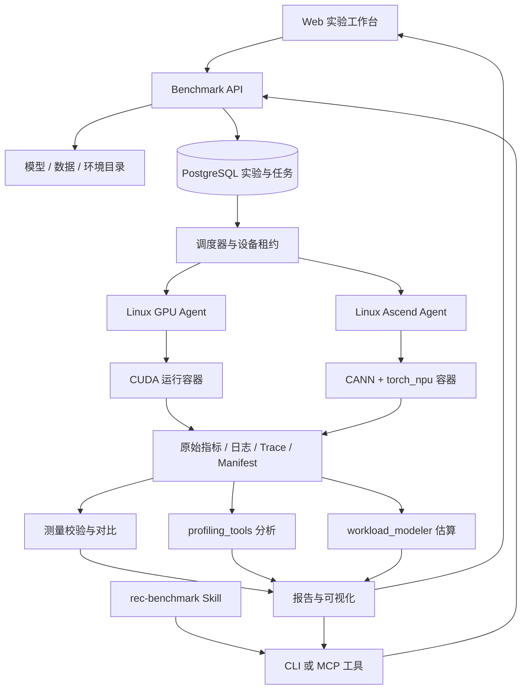

**推荐模型 Benchmark & Performance 平台方案**

状态：规划已归档，功能尚未实施。后续任务、依赖与验收清单见[实施计划](recommendation-benchmark-platform-roadmap.md)。

调研日期：2026-10-28。本文是基于公开一手资料与当前仓库静态检查的设计建议，尚未在 GPU/NPU 上验证部署、模型兼容性或性能。以下默认 NVIDIA GPU 与昇腾 NPU，执行节点为 Linux；其他 NPU 厂商需增加独立适配器。控制界面可从当前 Windows 工作站访问。

**建议在现有仓库上增加统一运行层，形成“Web / Skill → 同一份实验配置 → GPU/NPU 执行器 → 实测与诊断报告”的闭环。** 首期围绕少量固定节点、三个代表模型和单卡工作负载落地。现有 profiling 工具负责解释差异，新增 benchmark 引擎负责产生可复现的性能成绩。

**公开实现的取舍。** 本次查阅的项目各自覆盖流程的一部分；下面的组合与实施优先级是针对本仓库提出的设计判断。

| 参考实现 | 借鉴或复用 | 在本平台中的边界 |
|---|---|---|
| [MLPerf Training](https://github.com/mlcommons/training) | 模型、数据、质量目标、达到目标质量的耗时 | 借鉴训练评价协议；内部缩小模型不标记为正式 MLPerf 成绩 |
| [MLPerf DLRM-v2 推理实现](https://github.com/mlcommons/inference/tree/master/recommendation/dlrm_v2/pytorch) / [LoadGen](https://github.com/mlcommons/inference/tree/master/loadgen) | 数据准备、质量检查、推理压测；后期实现 SUT/QSL 接口 | LoadGen 不负责模型移植、训练或精度计算；使用它不等于符合整套 MLPerf 规则 |
| [TorchBench](https://github.com/pytorch/benchmark) | 统一模型接口、模型级依赖和 train/eval 入口 | 借鉴 adapter 组织方式，不能推断其全部模型支持昇腾 |
| [MLCFlow](https://docs.mlcommons.org/mlcflow/) / [MLPerf Automations](https://docs.mlcommons.org/mlperf-automations/) | Python 包装脚本、YAML 元数据、依赖、缓存、容器与实验组织 | 先参考 recipe 设计；正式接 MLPerf 时作为外部 workload executor 接入，避免同时维护两套任务状态机 |
| [TorchRec](https://meta-pytorch.org/torchrec/overview.html) / [FBGEMM](https://github.com/pytorch/FBGEMM) | embedding、分片规划、分布式推荐和 GPU 优化算子 | TorchRec 的优化依赖 FBGEMM 等后端能力，不能直接认为 CUDA 扩展可运行在 NPU |
| [Ascend Rec SDK](https://github.com/Ascend/RecSDK/blob/develop/README_en.md) | 昇腾推荐训练、TorchRec 适配、稀疏表和分片能力 | NPU 优化轨优先评估的已有实现；不同组件能力与版本支持不同，不能推断任意 TorchRec 模型无修改兼容 |
| [RecBole](https://github.com/RUCAIBox/RecBole) | 模型目录、统一数据格式、配置与推荐质量评价 | 可选择性导入模型；其训练器不能替代跨设备 benchmark 测量协议 |
| [Ascend PyTorch 兼容表](https://github.com/Ascend/pytorch/blob/master/COMPATIBILITY.en.md) | PyTorch、torch_npu、CANN、Python 配套关系 | 环境必须按实际芯片、驱动、固件及官方支持组合验收；不使用浮动的 latest 作为实验环境 |
| [msprof-analyze](https://github.com/Ascend/msprof-analyze/blob/master/docs/zh/user_guide/compare_tool_instruct.md) | 已有 GPU/NPU、NPU/NPU 性能比对及通信等分析入口 | 作为可选诊断插件或独立交叉检查；与现有引擎各自保留统计口径，不合并不同口径的总量 |
| [OpenAI Skills](https://developers.openai.com/plugins/concepts/skills) | 将重复工作流封装为 SKILL.md、脚本、模板或 MCP 工具调用 | Skill 负责组织流程与解释；持久任务状态、执行和数值计算由服务与代码负责 |

模型方向需要考虑时间变化：MLCommons 2026 年 10 月介绍的 DLRMv4 已采用 HSTU 与 Yambda-5B；当前训练仓库列出了相应实现。因此 DLRM-v2 可作为成熟历史基线，同时为序列推荐预留接口。完整的大规模 HSTU 基准应放在容量与分布式能力具备之后。[DLRMv4 官方介绍](https://mlcommons.org/2026/10/dlrmv4-training/)

**当前仓库已有分析基础，但缺少执行链路。** 下面的“已有”仅依据代码与文档，不表示本次做过运行验收。

| 模块 | 可复用能力 | 新平台需要补齐 |
|---|---|---|
| `profiling_tools` | trace 解析、调用与 kernel 关联、覆盖率、证据查询、报告和守恒校验 | 接收运行器自动产生的文件与 manifest；建立 run 到分析结果的关联 |
| `profiling_web` | FastAPI、Vue 3、ECharts、任务历史、取消、结果下钻 | 实验创建、资源状态、远程运行日志、跨实验比较和测量指标 |
| `workload_modeler` | 版本化硬件/平台规格、workload 画像、假设与预测 | 与真实执行节点关联；预测和实测分开展示 |
| `skills/gpu-npu-profiling` | 规范化分析流程、CLI 和证据解释 | 新建 `rec-benchmark` skill，负责创建与跟踪实验；保留原 skill 的分析职责 |
| `web_shared` | 共同主题和视觉规范 | 扩展平台导航与通用状态组件 |

依据：[仓库定位](../README.md)、[Web 运行边界](../profiling_web/README.md)、[现有分析 runner](../profiling_web/runner.py)、[Workload Modeler](../workload_modeler/README.md)。已有 Dockerfile 是分析服务镜像，不能当作模型执行镜像；已有队列也不能直接当作跨节点设备调度器。

现状检查包含 2026-10-28 工作区中已有的未提交变更；本次规划提交不包含这些代码。开始实施时需重新确认当前分支实际具备的能力，尤其是 `web_shared`、Workload Modeler 的规格管理与共享界面，避免把工作区观察当成已合入的基线。

**架构采用一个控制面、两个设备后端，以及共用的实验与产物协议。** 首期使用现有 FastAPI/Vue/ECharts 技术栈，新增 PostgreSQL 保存任务与资源状态。少量节点由 agent 拉取任务并启动本机容器；大文件先存控制节点专用目录，后续通过存储接口切换至 S3 兼容对象存储。



控制服务不必安装 CUDA/CANN，也不直接运行业务模型。现有分析 worker 保持独立，避免大 trace 解析拖住设备调度。执行器只接收注册的 workload、锁定镜像和校验后的参数，以结构化参数启动容器。

数据库持有唯一的任务状态；无需首期叠加 Celery、Redis、Argo 和 MLflow。agent 有独立身份与心跳，设备采用独占租约。多人共享时增加用户/项目权限，不能把当前本机共享 token 模式直接扩大为团队权限体系。若团队已有 Kubernetes 或 Slurm，优先对接现有集群，通过 executor 接口替换固定节点调度。

**实验分成三种模式和两条实现轨。** 模式决定“测什么”，实现轨决定“允许怎样实现”。两者都是必须写入配置、筛选器和报告的字段。

| 评测模式 | 测量内容 | 适用阶段 |
|---|---|---|
| 固定步数性能 | forward 或完整 train step，稳态吞吐、step 延迟、显存 | MVP 主线；train step 必须声明是否包含 backward、optimizer、通信与数据输入 |
| 推理服务性能 | 固定 checkpoint，业务质量、给定到达率/并发下吞吐和请求尾延迟 | 第二阶段；batch latency 不能当作在线请求 latency |
| 训练到目标质量 | 固定数据与评价协议，达到目标 AUC/NDCG 等所需总时间 | 后续；固定步数快不等于训练到目标更快 |

共同实现轨 `common-portable` 使用相同模型语义、权重、输入与数值策略，优先采用两端可支持的 PyTorch 算子。它用于建立可比基线，但跨硬件结果仍包含各自编译器、运行时和主机系统的差异。

后端优化轨 `backend-optimized` 允许 GPU 使用 FBGEMM/融合算子，NPU 使用经验证的专用实现；必须记录实现版本、算法与精度策略差异，并通过约定的质量门槛。此轨表示完整方案比较，不能把结果归因成纯芯片差距。两轨不混合排名。

NPU 优化轨应先评估 Rec SDK 的 TorchRec 适配能力，按模型核对 embedding、分片、优化器和自定义算子覆盖，减少自研范围。其安装配方有独立的 PyTorch/torch_npu/FBGEMM/Rec SDK 配套要求，必须与基础 torch_npu 兼容矩阵取交集，不能拼接任意版本。[Rec SDK 安装说明](https://github.com/Ascend/RecSDK/blob/develop/docs/en/torch/torch_rec_v1/recsdk_torch_installation_guide.md)

**模型适配和设备适配分开实现。** 借鉴 TorchBench 的模型接口思想，提出以下本平台接口；这些名称是设计草案，并非当前仓库已提供的 API。

```text
WorkloadAdapter
  capabilities()              # backend / dtype / mode / distributed / compile
  prepare_dataset(spec)
  build_model(spec, backend)
  load_checkpoint(checkpoint)
  make_batch(input_spec)
  train_step(batch) / infer_step(batch)
  validate(reference, policy)
  export_metadata()

BackendAdapter
  probe_environment()
  select_device()
  synchronize()
  autocast(policy)
  memory_stats()
  distributed_backend()
  profiler_session(config)
  export_profile()
```

`cuda` 和 `ascend` 后端分别实现同步、混合精度、内存统计、通信及采集。NCCL/HCCL、embedding 分片、稀疏梯度、融合优化器与编译器能力分别声明，不把替换 `.cuda()` 为 `.npu()` 视作适配完成。不支持的组合在计划阶段返回 `unsupported`；任何 CPU fallback 必须显式声明并进入独立测试类型，禁止静默混入加速器成绩。

**环境搭建分为节点准备与实验准备。** 节点准备安装并验证宿主机驱动、固件、设备容器 runtime 和通信条件；实验准备只选择已验收的软件镜像、代码和数据。容器并不能屏蔽宿主驱动兼容问题。

| 环境对象 | 必须冻结或记录的内容 |
|---|---|
| 硬件 | 厂商、芯片/SKU、设备数、显存、CPU/NUMA、内存、互联拓扑、功率/频率策略 |
| 宿主环境 | OS/kernel、驱动、固件、容器 runtime、设备挂载与权限、通信链路 |
| 模型镜像 | 镜像 digest、CPU 架构、Python、PyTorch、CUDA 或 CANN/torch_npu、通信库、依赖锁文件 |
| 模型与数据 | 代码 commit、本地补丁 hash、adapter 版本、checkpoint hash、数据与预处理版本 |
| 执行条件 | dtype、TF32/AMP、编译模式、embedding 放置、线程数、CPU 绑定、设备占用、随机种子 |

GPU/NPU 使用不同镜像，但尽量选取双方都支持的 PyTorch 版本。无法相同时，将框架差异保留为比较条件，不伪装成相同栈。镜像构建与缓存发生在正式测量前；每个镜像先通过 import、设备检查、矩阵运算、embedding、反向传播及小模型 smoke test，多卡阶段再加 collective 验收。具体版本在掌握实际卡型和节点后，按官方矩阵确定。

**推荐模型库按计算模式覆盖，首期控制在三个代表模型。**

| 阶段 | 模型/工作负载 | 想覆盖的性能特征 |
|---|---|---|
| 首期 | DeepFM 或 DCNv2 的可移植小模型 | embedding、MLP、特征交互 |
| 首期 | 小型 DLRM | 多表 embedding、pooling、稠密/稀疏混合、反向更新 |
| 首期 | DIN | 变长用户序列、attention 与 gather/scatter |
| 扩展 | 成熟历史 DLRM-v2 标准配方 | 大规模 multi-hot、真实数据与质量目标 |
| 扩展 | HSTU / DLRMv4 相关配方 | 长序列、jagged tensor、融合算子、大 embedding |
| 扩展 | 分布式 embedding、AllToAll、GEMM 微基准 | 隔离通信、带宽与算子瓶颈；辅助解释模型结果 |

如果主要业务已采用 HSTU，可将首期 DIN 替换为经简化且明确标记的 HSTU workload，保持首期模型数量不变。官方规模的模型、真实业务模型和缩小的内部 workload 使用不同 ID，不能只因名称相似就横向排名。

数据分三层：合成数据验证执行与定位瓶颈；固定公开数据子集验证业务质量；正式数据规模评估真实资源压力。需要保存表容量、embedding 维度、ID 热点/访问分布、multi-hot 长度分布、序列长度分布、重复率、padding 与截断策略。相同 seed 不保证不同后端随机生成的数据相同；严格配对实验优先使用统一 CPU 生成并持久化的输入，以及相同 checkpoint。

真实数据增加数据集许可/获取方式、split、特征词表、预处理代码及输出校验和。CTR 质量用 AUC/logloss；召回和序列推荐用 Recall@K/NDCG@K，并冻结候选集和负采样协议。合成数据上的数值一致性通过只能说明功能门禁通过，不能代表真实质量达标。

**端到端流程以可恢复的阶段呈现。** 一次用户实验展开为多个 run，每个 run 对应一个明确的后端、模型、精度、batch 与重复编号。

```text
创建实验 → 校验配置与兼容性 → 分配设备 → 准备镜像/代码/数据
        → 正确性检查 → 编译/预热 → 正式性能测量 → 保存实测结果
        → 独立 Profiling 运行 → 产物校验 → 双侧分析 → 报告
```

正式测量与 profiling 是关联的独立执行记录。性能阶段关闭 profiler；profiling 阶段复用被冻结的 workload 条件并选取有代表性的稳定 step。profiling 失败时保留有效实测结果，单独显示诊断失败。分析不得根据相同 step 编号自动认定两端工作量相同。

正确性门禁必须覆盖正式测量实际使用的精度、编译和融合路径；启用编译时先准备该路径再校验。校验、pilot、预热会改变训练状态，因此每次正式重复和 profiling 重放前恢复受控的模型、optimizer、随机状态与数据游标，再执行双方一致的预热与输入序列。记录 profiling 的逻辑步骤偏移，确保它对应约定训练阶段。状态恢复和编译准备在正式计时窗外完成。

每个阶段记录开始/结束、状态、日志和产物。API 提交返回实验 ID 后立即结束请求，关掉浏览器或结束对话不影响运行。建议状态包括 `queued / preparing / validating / warming / measuring / profiling / analyzing / succeeded`，终止状态区分 `failed / canceled / unsupported`，并分别记录 performance、quality、profile 的有效性。

设备租约含心跳与 fencing token；控制面重启可从数据库恢复。节点失联后先进入待核实状态，确认旧进程已结束后再复用设备，不能仅因租约超时就启动第二份工作。取消需终止容器/分布式进程组并确认资源释放。基础设施错误可有限重试并创建新 attempt；数值错误、OOM 与不支持的算子保留原始失败证据。

**测量协议先于排行榜实现。** PyTorch 的 benchmark 工具明确考虑预热及异步设备同步，本平台也必须在各后端验证这些行为，不能仅测 Python 发起调用的时间。[PyTorch benchmark 文档](https://docs.pytorch.org/docs/2.14/benchmark_utils.html)

| 指标 | 建议定义与约束 |
|---|---|
| 模型吞吐 | 计时窗口内实际完成的样本数 / 墙钟秒数；训练记录全局 batch 与梯度累积，不能无条件再乘卡数 |
| step latency | 定义清楚的 step 完成时间，报告分布；孤立同步 step 与连续执行均摊 step 分开 |
| 推理请求延迟 | 从约定请求入口到完成的端到端延迟，保留到达率、排队、并发和批处理策略 |
| 内存 | 分别记录框架 allocated/reserved 峰值和设备级占用；不同来源不混为一个指标 |
| 质量 | 分别记录数值一致性和业务质量，失败结果仍可诊断但不进入通过门槛的榜单 |
| 训练效率 | 到达质量目标的时间与完整训练预算，和固定步数吞吐分开 |
| 功率与能耗 | 仅在采样源、时间窗和设备/系统边界明确时报告；不同厂商利用率计数器不默认等价 |
| kernel / 通信时间 | 作为诊断信息；事件时长求和可能含重叠，不能替代墙钟 step 时间 |

至少区分 `device_only`（输入已在设备，协议明确计算边界）与 `end_to_end`（包含数据读取/组 batch、传输和计算）两种范围。数据预处理、镜像拉取、初始化和编译耗时单独展示。吞吐测试在测量窗口边界正确同步，避免为每一步添加屏障改变流水；需要孤立 step 分布时另设测试模式。多卡测量需要保证所有 rank 完成，并保存各 rank 和整体范围。

MVP 的可调整起点是每组配置 5 次独立重复、至少 50 个共同预热 step。先用独立 pilot 确定双方一致的正式步数 N（建议 N 至少 200，并使两端正式计时都达到约 30 秒），再冻结 N 与输入序列；正式运行不能由每个后端自行按时长停止。若计时不足，增加整组实验的 N 后重测。固定时长吞吐可作为另一种明确协议。这些是内部建议值，不是 MLPerf 规则。编译或动态 shape 工作负载需在 pilot 中确定更长的共同预热与稳定性条件，无法稳定就标记不稳定。5 次独立运行用于评估运行间波动；尾延迟需要足够的请求样本与指定负载，不能由少量汇总点生成可信 P99。

结果默认报告各次原始值、中位数与波动范围。持续回归固定节点、软件栈和协议，必要时交替执行 baseline/candidate，采用重复实验与区间估计排查噪声。可将“超过 5% 且超过观测噪声”作为初始告警策略，但需由首批稳定性实验校准；不得把所有波动都判作回归。

跨设备比较前必须检查模型版本、输入/checkpoint、模式、batch、精度策略、warmup、计时范围、实现轨、分片和 embedding 放置等条件。硬件和后端软件的差异作为比较维度明确展示；协议不一致的结果只能并排查看。若采用速度倍率，明确 `NPU 相对 GPU 的速度 = GPU 时间 / NPU 时间`，同样工作量下大于 1 表示 NPU 更快。不能与反方向的时间倍率混淆。

**一次实验必须留下可追溯记录。** 推荐对象关系为 `Experiment → Run → Attempt → Metric / Artifact`；对比对象额外引用两端 run、对应 profiling 执行、范围选择以及分析引擎版本。计划阶段的输入条件指纹与运行后的环境指纹分别记录，不能因为环境不同就丢失 workload 配对关系。

```text
实验记录
  resolved_spec.json          # 展开后的完整配置与协议版本
  manifest.json               # 代码/数据/checkpoint/环境/硬件指纹
  correctness.json            # 数值检查、质量指标和门槛结果
  metrics.json               # 带 unit、scope、来源和有效性的指标
  measurements.jsonl         # 原始重复/窗口/请求样本
  stdout.log / stderr.log
  profile/<profile_run_id>/   # 原始采集、metadata、导出文件
  analysis/<analysis_id>/     # 现有分析引擎产物与版本
```

大文件先在 agent 本地完整落盘，生成内容 hash 后上传；服务端校验 hash 并原子发布产物清单。重试不能覆盖已完成结果。数据库只保存结构化记录、索引和产物地址，不保存整个 trace。采集格式与解析器版本必须固定：缺少 NPU kernel 明细时标记 profile 不完整，不能填空文件伪造“没有算子”；字段缺失或 step 不明确应阻止依赖该信息的分析。

对接 Ascend profiler 时固定 Text 导出与 NPU activity；`kernel_details.csv`、内存和通信文件是否生成取决于采集设置，Step Id 也可能为空。保存原始数据、导出文件及 profiler 配置，按范围校验后再交给分析引擎。[Ascend PyTorch Profiler 指南](https://www.hiascend.com/document/detail/en/mindstudio/2600/TITools/ascend_pytorch_profiler/docs/en/ascend_pytorch_profiler/ascend_pytorch_profiler_user_guide.md)

下面是建议的配置草案，示例 ID 和参数需在模型及环境目录注册后才能运行；当前仓库尚未实现这些字段或命令。

```yaml
schema_version: recbench/v1
name: dlrm-small-portable-pair
workload:
  id: dlrm-small
  revision: "<pinned-model-commit>"
  implementation_track: common-portable
  mode: train_step
  parameters:
    embedding_dim: 64
    table_sizes: [100000, 100000, 100000]
    pooling: sum
data:
  id: synthetic-fixed-inputs-v1
  artifact_sha256: "<resolved-input-hash>"
  sequence_distribution: fixed-20
  access_distribution: "<registered-distribution-profile>"
initial_state:
  checkpoint_sha256: "<shared-initial-state-hash>"
  training_state_sha256: "<optimizer-rng-and-data-cursor-state-hash>"
targets:
  - backend: cuda
    environment: "<validated-gpu-environment-id>"
    devices: 1
  - backend: ascend
    environment: "<validated-npu-environment-id>"
    devices: 1
matrix:
  batch_size: [256, 1024]
  precision: [fp32]
measurement:
  scope: end_to_end
  protocol: fixed_steps
  pilot_target_seconds: 30
  warmup_steps: 50
  measure_steps: "<pilot-derived-shared-N>"
  independent_repeats: 5
  restore_state_before_each_repeat: true
  profiler_enabled: false
correctness:
  policy: "<model-specific-validated-policy>"
profile:
  separate_run: true
  stable_steps: 3
  capture_shapes: true
  capture_stacks: false
```

正确性 policy 应明确输出、loss、梯度/更新检查以及 dtype 对应容差；不能只检查“loss 是有限数”。示例合成数据不能配置成真实业务质量已通过。每个 target 在解析后拥有自己的环境 digest，镜像和数据指纹进入最终 manifest。

**Web 与 Skill 使用同一个服务接口。** Web 负责长期可视化和交互，Skill 负责把自然语言转换为配置、调用工具、跟踪状态并解释证据。

| 页面 | 需要呈现的内容 |
|---|---|
| 环境与设备 | 节点健康、卡型、驱动/软件版本、验证状态、空闲/占用、环境配方 |
| 模型与数据 | adapter、可用后端/精度/模式、数据来源、表/序列分布与质量协议 |
| 创建实验 | 模型 × backend × batch × dtype 矩阵、指标口径、资源需求、实验展开预览 |
| 运行详情 | 持久阶段进度、实时日志、开始/结束时间、指标曲线、取消与失败原因 |
| 实测比较 | 同条件筛选、吞吐/延迟/显存、波动、质量状态、环境差异、历史回归 |
| 性能诊断 | 复用现有类型、shape、CPU scope、kernel、覆盖率与证据下钻 |
| 性能估算 | 复用 workload_modeler，始终标明预测假设、覆盖率和待验证部分 |

阶段进度只展示真实状态；未知时长阶段不用虚构整体完成百分比。Web 可先采用现有轮询模式，再按日志规模添加 SSE。原始 trace 下载与现有报告继续可用；远期增加时间线查看器，但它不作为平台首期阻塞项。

建议 API 包括 `validate_spec / create_experiment / submit / get_status / list_metrics / cancel / compare / list_artifacts`。创建/提交支持幂等键，避免 Skill 重试导致重复占卡。数据、权限和状态存储在服务中。

Skill 的典型交互可以是：用户输入“用两台已注册机器测 DLRM，batch 256 和 1024，比较 FP32 train step”。Skill 选择已有模板并解析配置，提交后返回实验链接；运行完成后按质量有效性、端到端指标、再到算子证据的顺序报告。MVP 可调用同一个 Python CLI/HTTP API；有跨机器工具发现需求时再封装 MCP。CLI、Web 与 Skill 都不各自维护一套统计公式。

**建议的代码增量。** 先新增边界清晰的运行模块，通过接口接入当前分析工具。下面都是建议新增结构，不代表已经实现。

```text
benchmark_core/
  schema.py                  # spec / manifest / metric / artifact
  workloads/                 # 模型适配器与能力声明
  backends/                  # cuda / ascend
  measurement/               # 正确性、计时、重复与独立采集
  cli.py
benchmark_service/
  api/                       # 实验、运行、指标、产物
  scheduler/                 # 资源匹配、独占租约、状态恢复
  agent/                     # 节点预检、容器启动、日志与产物上传
  integrations/              # profiling_tools、现有工作台桥接
benchmark_catalog/
  environments/
  models/
  datasets/
  suites/
skills/rec-benchmark/
profiling_tools/              # 复用
profiling_web/frontend/       # 扩展平台导航和页面
workload_modeler/             # 保持估算职责
```

逐步抽取硬件/平台目录的共用 schema；先读取和冻结现有版本快照，不立即合并两个现有工具的数据库。实验编排数据库、分析任务和预测任务通过明确 ID 关联，防止“分析完成”被误认为“模型 benchmark 成功”。

**实施节奏建议为 6–8 周完成可用 MVP。** 这是以 2 名工程师、兼职性能/运维支持、现成可访问的 GPU/NPU 节点为前提的估计；复杂 NPU 算子移植、设备采购、官方规模数据准备与多机训练不包含在此周期内。

首版默认范围固定为单卡、FP32、eager、共同实现轨和固定步数 train step，可额外提供同模型 forward 测试。混合精度、编译、后端优化和分布式能力先进入 schema 与能力声明，未经单独验收不开放执行。

| 时间 | 交付内容 | 验收条件 |
|---|---|---|
| 第 1 周 | 设备盘点、版本组合、Spec/Manifest/指标协议、首个小模型 | 同一输入与初始状态在两端完成数值检查，环境可重建 |
| 第 2–3 周 | 两类容器/agent、任务状态、CLI、正式测量和独立 profiling | 一个实验自动跑两端；产物完整；关闭客户端不影响任务 |
| 第 4–5 周 | Web 流程、Skill、三个模型、分析引擎桥接 | Web 和 Skill 的同配置产生相同配置指纹；能从差异进入现有证据页 |
| 第 6–8 周 | 固定真实数据子集、重复实验、历史比较、故障恢复与回归报告 | 质量门槛生效；失败/取消/重启可追溯；同条件重复波动可量化 |
| 后续 | 服务推理/LoadGen、训练到目标质量、多卡/多机、HSTU 与优化轨 | 每个能力有单独的正确性、资源与测量验收后才进入正式 suite |

MVP 的终点应是：用户在 Web 或 Skill 选择模型与两种后端，一次提交后可看到环境准备、运行与分析过程；得到带质量状态、波动和完整环境指纹的实测比较，且能定位到原始日志和 profiling 证据。

首期最需要的验证包括：计时确实等待设备完成；统计公式处理实际样本数和梯度累积；错误结果不会进入有效榜单；同设备不会重复分配；取消清理完整；控制面重启不丢运行记录；上传校验阻止不完整产物；profiling 开关不污染正式测量。现有合成 trace 适合解析器回归，不能用于证明硬件执行链路可用。

**扩容时按出现的问题增加组件。** 当节点和用户增多时，再接入集群资源调度、对象存储、身份系统、时序监控及可选实验追踪。[MLflow Tracking](https://mlflow.org/docs/latest/ml/tracking/) 可作为指标/产物镜像，核心任务和协议记录仍只有一个事实来源。多卡调度需要一组设备同时分配以及失败清理；换成 Kubernetes 也不会自动解决模型/通信栈适配。若选用 Volcano，按实际芯片核对其设备插件和模式支持，正式 benchmark 默认整卡独占。[Volcano Ascend 指南](https://volcano.sh/docs/userguide/user_guide_how_to_use_vnpu/)

GPU 低频资源遥测可评估 [DCGM](https://docs.nvidia.com/datacenter/dcgm/latest/learn/modules/profiling.html)，疑难 CPU/设备重叠问题可单独使用 [Nsight Systems](https://docs.nvidia.com/nsight-systems/UserGuide/)。NPU 选择对应设备支持的采样接口。监控需记录采样粒度和开销，并协调 profiler 的计数器占用；利用率曲线只作上下文，不替代模型测量。

实施前仍需确认实际 GPU/NPU 型号与数量、是否已有 Kubernetes/Slurm、首期最重要的模型、训练/推理优先级、可用数据及隔离要求。这些信息影响环境配方和排期，不影响“统一协议、分后端执行、共用分析、Web/Skill 共用 API”的总体结构。
